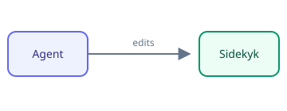

# Vault guide

Notes kept as **Markdown**, read in *Sidekyk* with `code`, ~~gone~~ and a line<br>broken here.
See [the index](index.md), [ideas at their top](ideas.md#ideas), [a missing note](gone.md),
[the website](https://example.com), [a script](javascript:alert(1)) and [Setup](#setup)[^why].

[](https://example.com/ci)




## Setup

1. Open the folder
2. Read the notes
3. Write more[^why]

- [x] Install the app
- [ ] Try the preview

```ts
export function greet(name: string): string {
    return `Hello, ${name}`;
}
```

> A quote, as plain as it gets.

> [!NOTE]
> Notes stay on this machine.

> [!IMPORTANT]
> The preview reads; your editor writes.

> [!WARNING]
> Nothing here runs: <script>alert(1)</script> stays text.

| Note | Words | Kind |
|:-----|------:|:----:|
| ideas | 120 | list |
| papers | 3400 | reading |

    an indented block, as code

---

## Setup

The same heading twice gets another id[^more].

[^why]: Because a guide helps.
[^more]: GitHub numbers repeats `-1`, `-2`.
